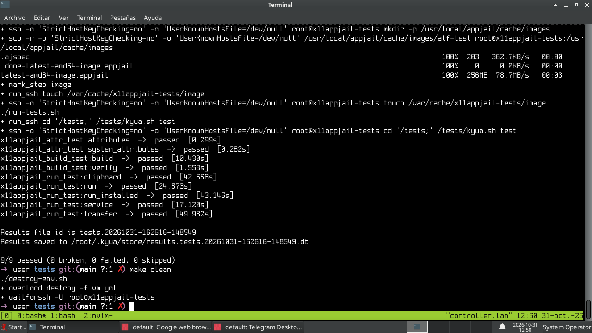

Testing in x11appjail is performed using FreeBSD's [ATF project](https://github.com/freebsd/atf), which uses Kyua under the hood.

To simplify the process and avoid interfering too much with the host system, a VM is used as the testing environment.

1. Install Overlord and friends.

   Overlord is used to deploy a VM. It actually uses [vm-bhyve](http://github.com/FreeBSD/vm-bhyve), but you don't need to worry about that, since it will be installed in a jail. However, make sure you can use the virtualization features required by `bhyve(8)`.

   It is recommended that you use [AppJail.setup](https://github.com/DtxdF/AppJail.setup) to install Overlord and friends.

   **ZFS**:

   ```console
   $ ./AppJail.setup --enable-common --enable-zfs --overwrite-resolv-conf --with-overlord --with-reproduce
   ```

   **UFS**:

   ```console
   $ ./AppJail.setup --enable-common --overwrite-resolv-conf --with-overlord --with-reproduce
   ```
2. Install [sysutils/waitforssh](https://freshports.org/sysutils/waitforssh).
3. Build the AppJail image used by this testing suite.

   ```console
   $ ./atf-test/.reproduce/build.sh
   ```
4. Configure the `.env` file.

   ```console
   $ cp .env.sample .env
   $ $EDITOR .env
   ```
5. Start `ssh-agent(1)` and add your SSH key to the agent, since you must use passwordless authentication.

   ```console
   $ eval `ssh-agent`
   $ ssh-add /path/to/your/ssh_key
   ```
6. Profit!

   ```console
   $ make
   ```

   
